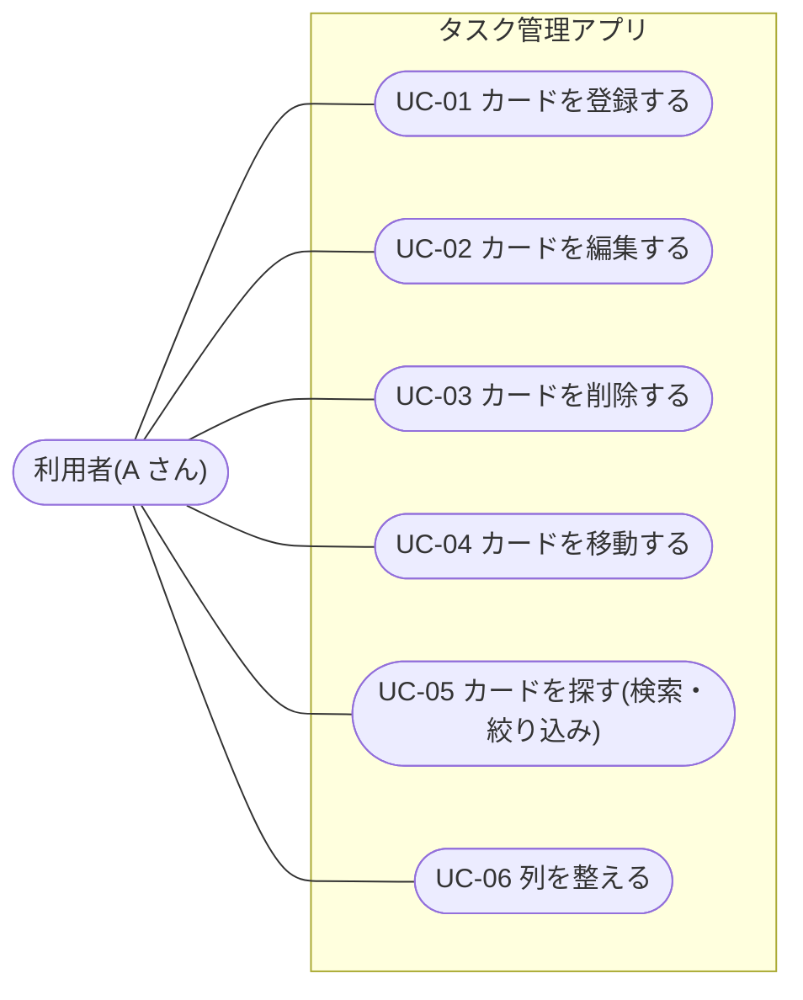
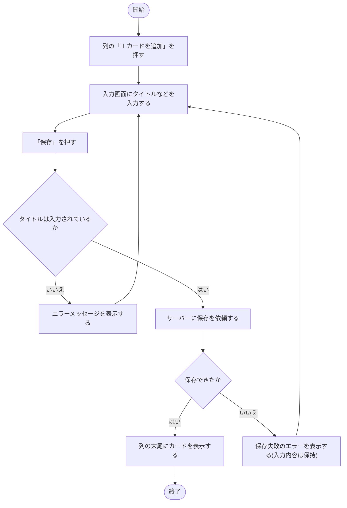
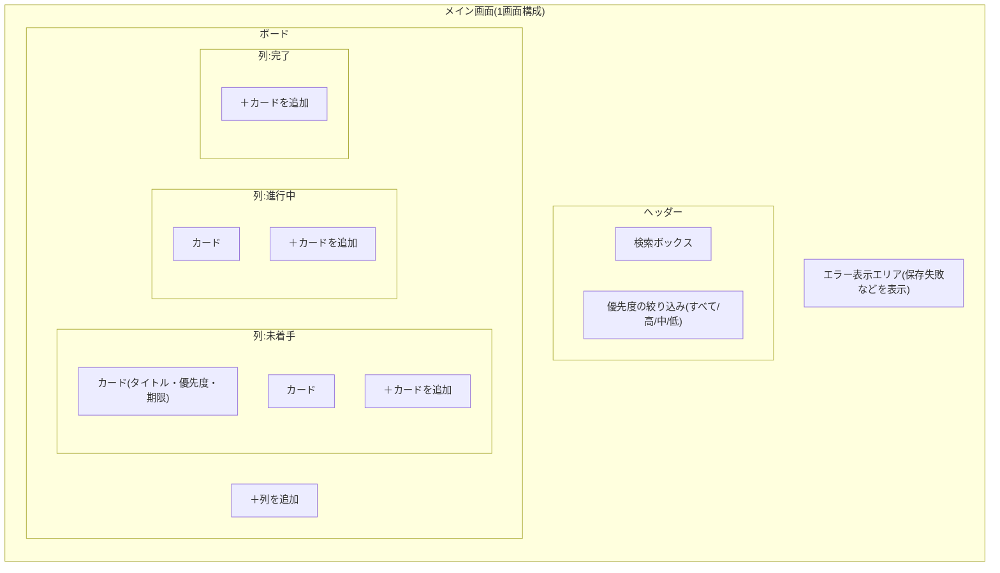
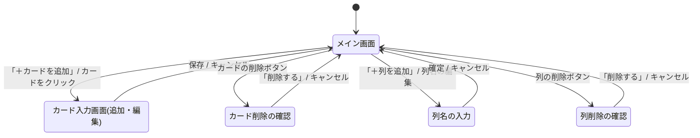
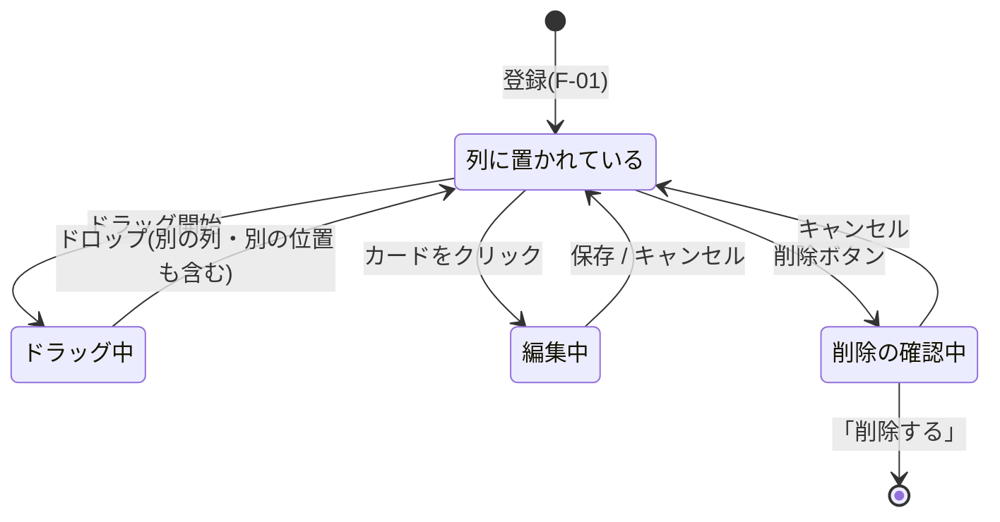
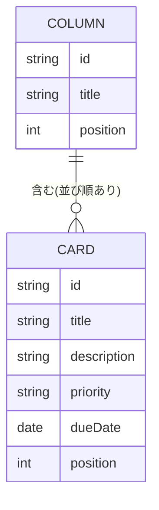
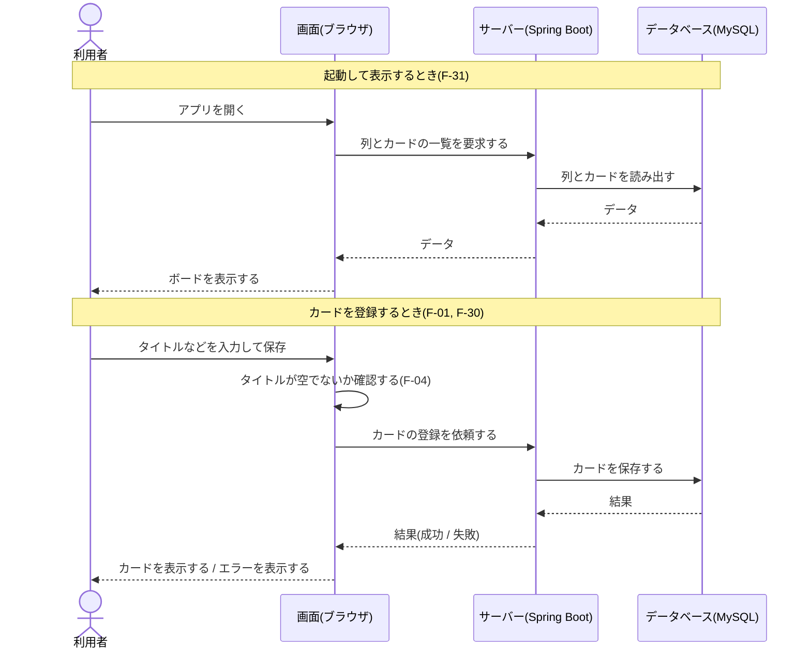
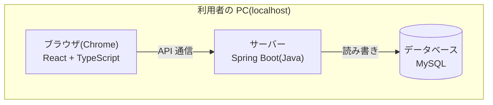

# 要件定義書:タスク管理アプリ(Trello風)

| 項目 | 内容 |
|---|---|
| 版 | 0.2(下書き) |
| 作成日 | 2026-11-26 |
| 状態 | レビュー待ち(未決事項は 8章を参照) |
| 変更点(v0.1 → v0.2) | 背景・課題・導入効果、受け入れ条件、ユースケース、画面仕様、データの整理、非機能要件の具体化、技術選定を追加。保存方式を localStorage から DB(MySQL)に変更。講師の指定に合わせ、技術を React + TypeScript(画面)/ Spring Boot(サーバー)に決定 |

> **この文書の読み方**
> - **要件定義**とは、「何を作るか(What)」を決めることです。「どう作るか(How)」は、このあとの基本設計で決めます。
> - 図は **Mermaid 記法**で書いています。GitHub 上では図として表示されます。VSCode では、標準のプレビューで表示されない場合があります。
> - **「仮」と書いた数字や設定は、想定です。** 事実ではなく、あとで修正できます。

---

## 1. 背景・課題・導入効果

### 1.1 架空のクライアント設定(仮)
この文書は、次のクライアントから依頼を受けた、という想定で書いています。

| 項目 | 内容 |
|---|---|
| クライアント | A さん(架空)。フリーランスの Web 制作者で、1人で仕事をしている |
| 利用者 | A さん本人のみ |
| 利用環境 | 自分の PC(Chrome を使用) |
| 状況 | 複数の案件と学習を並行しており、やることが常に5〜15件ある |

### 1.2 背景
- A さんは今、タスクをメモ帳、チャット、頭の中に分けて管理している。
- 案件が増え、「何を、いつまでに、どの順番でやるか」を、一目で把握しにくくなった。

### 1.3 現状の課題(数字は仮)
| No. | 課題 | 現状の目安(仮) |
|---|---|---|
| P-1 | 期限を見落とす | 月に2〜3回 |
| P-2 | 進み具合の確認に時間がかかる | 毎日約10分 |
| P-3 | 優先順位がはっきりせず、後回しにしたタスクが埋もれる | 月に数件 |
| P-4 | タスクの情報が複数の場所に散らばる | メモ・チャット・頭の中 |

**原因**:タスクが1か所にまとまっておらず、期限・優先度・進み具合が同じ画面で見えないため。

### 1.4 目的と目標
| 区分 | 内容 |
|---|---|
| 目的 | タスクを1か所に集め、期限・優先度・進み具合を一目で把握できるようにする |
| 目標 1 | 期限の見落としを、月0件にする(P-1) |
| 目標 2 | 進み具合の確認を、毎日2分以内にする(P-2) |
| 目標 3 | 全タスクを、このアプリに集約する(P-3, P-4) |

### 1.5 導入効果
- 期限・優先度が見えることで、**見落としを防げる**。
- 列(未着手 / 進行中 / 完了)で、**進み具合をすぐに確認できる**。
- 確認の時間を減らし、**作業そのものに時間を使える**。
- データを自分の PC に保存するので、**外部サービスに依存せず**、他人に見られない。

### 1.6 費用対効果(仮)
| 項目 | 内容 |
|---|---|
| 開発にかかる工数 | 約30時間 |
| 削減できる時間 | 確認の毎日8分短縮(10分→2分)× 月20日 = 月約2.7時間 |
| 時間だけで見た回収期間 | 約11か月 |
| 時間以外の効果 | 期限の見落としによる納期遅れ・信頼低下を避けられる。この効果が主な価値である |

※ 時間の削減だけでは、回収まで長くかかる。そのため、**期限の見落とし防止**を最も重視する。

### 1.7 代替案との比較(仮)
| 案 | 良い点 | 懸念 |
|---|---|---|
| 既存のタスク管理サービス(Trello など) | すぐに使える。機能が豊富 | 機能が多すぎて個人には過剰。データが外部サービスにある。無料枠の制限や仕様変更の影響を受ける |
| メモアプリ・表計算 | 手軽。追加費用がない | 進み具合を、列で見ることが難しい。期限や優先度で絞り込みにくい |
| 紙・付箋 | 最も手軽 | 検索できない。PC の作業と別の場所になる |
| **本アプリを作る(採用)** | 必要な機能だけを持てる。データを自分で管理できる。自分に合わせて変えられる | 開発の工数がかかる。保守は自分で行う |

### 1.8 成功の判断基準(KPI)
導入から1か月後に、次を確認する。

| 指標 | 基準 |
|---|---|
| 期限の見落とし | 0件 |
| 毎日の確認時間 | 2分以内 |
| タスクの集約 | 進行中の全タスクが、アプリに登録されている |
| 継続して使えているか | 週5日以上、アプリを開いている |

### 1.9 承認の根拠(まとめ)
次の理由から、本アプリを作ることを提案する。

1. **課題が明確**:期限の見落としと、確認の手間という、具体的な困りごとがある(1.3)。
2. **効果が測れる**:見落とし0件、確認2分以内という基準で、効果を確認できる(1.8)。
3. **範囲が小さく、実現できる**:1人・1画面・主要機能のみに絞っている(5章)。
4. **代替案より適している**:必要な機能だけを持ち、データを自分で管理できる(1.7)。
5. **リスクを把握している**:データの保管場所、保存の失敗などの扱いを、非機能要件に明記している(6章)。

---

## 2. 機能要件と受け入れ条件

**受け入れ条件**とは、「どうなっていれば、その機能が完成したと言えるか」を、確認できる形で書いたものです。
優先度: **必須**=第1版で必ず作る / **任意**=余裕があれば作る

### 2.1 カード

| ID | 機能 | 内容 | 受け入れ条件(このとき、こうなる) | 優先度 |
|---|---|---|---|---|
| F-01 | カード追加 | タイトル・説明文・優先度・期限日を入力して追加する | 列の「＋カードを追加」から入力して保存すると、その列の末尾にカードが表示される | 必須 |
| F-02 | カード編集 | 追加済みのカードの内容を修正する | カードをクリックして内容を変えて保存すると、カードの表示が更新される。画面を再読み込みしても、変更が残っている | 必須 |
| F-03 | カード削除 | カードを削除する。削除前に確認を表示する | 削除ボタンを押すと確認が表示される。「削除する」を選ぶとカードが消え、「キャンセル」を選ぶと何も変わらない | 必須 |
| F-04 | 入力チェック | タイトルが未入力のときは、登録できない | タイトルが空(空白のみを含む)で保存を押すと、エラーメッセージが表示され、カードは作られない | 必須 |
| F-05 | 期限の強調 | 期限日を過ぎたカードを目立たせる | 期限日が今日より前のカードは、赤色などで強調して表示される | 任意 |

**カードの項目**

| 項目 | 必須 | 内容 |
|---|---|---|
| タイトル | はい | カードの題名 |
| 説明文 | いいえ | 複数行の文章 |
| 優先度 | はい | 高 / 中 / 低(初期値:中) |
| 期限日 | いいえ | 日付(年月日) |

※ 文字数の上限などのバリデーションルールは、基本設計で決めます。

### 2.2 列(リスト)

| ID | 機能 | 内容 | 受け入れ条件 | 優先度 |
|---|---|---|---|---|
| F-10 | 初期列 | 初回起動時に「未着手」「進行中」「完了」を表示する | データが空の状態で開くと、3つの列が表示される | 必須 |
| F-11 | 列追加 | 新しい列を追加する | 「＋列を追加」で名前を入力して保存すると、右端に新しい列が表示される | 必須 |
| F-12 | 列名変更 | 列の名前を変更する | 列名を変更して確定すると、新しい名前が表示される。再読み込み後も変わらない | 必須 |
| F-13 | 列削除 | 列を削除する。削除前に確認を表示する | 確認には「列内のカードも削除される」と表示される。「削除する」で列とカードが消え、「キャンセル」で何も変わらない | 必須 |

### 2.3 カードの移動

| ID | 機能 | 内容 | 受け入れ条件 | 優先度 |
|---|---|---|---|---|
| F-20 | 列間の移動 | カードをドラッグ&ドロップで別の列に移す | カードを別の列にドロップすると、その列に表示される。再読み込み後も、移動先の列に残っている | 必須 |
| F-21 | 列内の並び替え | 同じ列の中で、カードの順番を入れ替える | カードを同じ列の別の位置にドロップすると、順番が変わる。再読み込み後も、順番が保たれている | 必須 |

### 2.4 保存

| ID | 機能 | 内容 | 受け入れ条件 | 優先度 |
|---|---|---|---|---|
| F-30 | 自動保存 | 操作のたびに、データベースへ保存する | カード・列を変更したあと、「保存」ボタンを押さなくても、変更がデータベースに記録される | 必須 |
| F-31 | 復元 | 起動時に、保存した内容を表示する | ブラウザを閉じて開き直しても、サーバーを再起動しても、保存した内容が表示される | 必須 |

### 2.5 検索・絞り込み

| ID | 機能 | 内容 | 受け入れ条件 | 優先度 |
|---|---|---|---|---|
| F-40 | タイトル検索 | 入力した文字を含むカードだけを表示する | 検索ボックスに文字を入れると、タイトルにその文字を含むカードだけが表示される。空にすると全件が表示される | 必須 |
| F-41 | 優先度の絞り込み | 優先度を選び、該当するカードだけを表示する | 「高」を選ぶと、優先度が高のカードだけが表示される。「すべて」で全件が表示される | 必須 |

---

## 3. ユースケースと操作フロー

**ユースケース**とは、「利用者が、システムを使って何をするか」を、1つの目的ごとにまとめたものです。

### 3.1 ユースケース図

図の見方:左の人が利用者、丸い枠が、利用者がアプリでできることです。

### 3.2 ユースケース一覧と対応する機能

| ID | ユースケース | 目的 | 対応する機能 |
|---|---|---|---|
| UC-01 | カードを登録する | やることを漏れなく記録する | F-01, F-04, F-30 |
| UC-02 | カードを編集する | 内容や期限の変更を反映する | F-02, F-04, F-30 |
| UC-03 | カードを削除する | 不要になったタスクを消す | F-03, F-30 |
| UC-04 | カードを移動する | 進み具合や順番を更新する | F-20, F-21, F-30 |
| UC-05 | カードを探す | 見たいタスクをすぐに見つける | F-40, F-41 |
| UC-06 | 列を整える | 自分に合った分け方にする | F-11, F-12, F-13, F-30 |

### 3.3 ユースケース記述(主なもの)

**UC-01 カードを登録する**

| 項目 | 内容 |
|---|---|
| 事前条件 | メイン画面が表示されている |
| 基本の流れ | 1. 列の「＋カードを追加」を押す。 2. 入力画面で、タイトルなどを入力する。 3. 「保存」を押す。 4. カードが、その列の末尾に表示される |
| 例外 | タイトルが空:エラーを表示し、登録しない。 保存に失敗:エラーを表示し、入力内容は保持する |
| 事後条件 | カードがデータベースに記録されている |

**UC-04 カードを移動する**

| 項目 | 内容 |
|---|---|
| 事前条件 | 1枚以上のカードが表示されている |
| 基本の流れ | 1. カードをドラッグする。 2. 移動したい列・位置にドロップする。 3. カードが新しい位置に表示される |
| 例外 | 保存に失敗:エラーを表示し、元の位置に戻す |
| 事後条件 | 新しい列と順番が、データベースに記録されている |

**UC-05 カードを探す**

| 項目 | 内容 |
|---|---|
| 事前条件 | メイン画面が表示されている |
| 基本の流れ | 1. 検索ボックスに文字を入力する、または優先度を選ぶ。 2. 条件に合うカードだけが表示される。 3. 条件を空にすると、全件が表示される |
| 例外 | 該当するカードが0件:「該当するカードはありません」と表示する |
| 事後条件 | データは変更されない(表示だけが変わる) |

**UC-06 列を整える**

| 項目 | 内容 |
|---|---|
| 事前条件 | メイン画面が表示されている |
| 基本の流れ | 追加:「＋列を追加」で名前を入力する。 名前変更:列名を編集して確定する。 削除:列の削除を押し、確認で「削除する」を選ぶ |
| 例外 | 列の削除では、列内のカードも消えることを確認画面に表示する |
| 事後条件 | 変更が、データベースに記録されている |

### 3.4 操作フロー図:カードを登録する

図の見方:上から下へ、操作の流れを追います。ひし形は、条件による分かれ道です。

---

## 4. 画面仕様

### 4.1 画面レイアウト図(ワイヤーフレーム)

図の見方:入れ子の枠が、画面の部品の配置です。外側がメイン画面、内側が各部品です。
※ Mermaid には、ワイヤーフレーム専用の記法がないため、枠の入れ子で表現しています。

### 4.2 各部品の表示と動作

| 部品 | 表示内容 | 動作 |
|---|---|---|
| 検索ボックス | 入力欄 | 文字を入力すると、タイトルに含むカードだけを表示する(F-40) |
| 優先度の絞り込み | 選択肢(すべて/高/中/低) | 選ぶと、該当する優先度のカードだけを表示する(F-41) |
| 列 | 列名、カードの一覧、「＋カードを追加」、列の編集・削除 | 列名の編集(F-12)、列の削除(F-13) |
| カード | タイトル、優先度、期限日(期限切れは強調) | クリックで編集(F-02)、削除ボタン(F-03)、ドラッグで移動(F-20, F-21) |
| 「＋列を追加」 | ボタン | 列名を入力して、新しい列を追加する(F-11) |
| エラー表示エリア | エラーメッセージ | 保存失敗、サーバーに接続できない場合などを表示する |

### 4.3 状態ごとの表示

| 状態 | 表示 |
|---|---|
| 初回起動(データなし) | 「未着手」「進行中」「完了」の3列を、カードなしで表示する |
| 列にカードがない | 列に「カードがありません」と薄く表示する |
| 検索・絞り込みの結果が0件 | 「該当するカードはありません」と表示する |
| 期限切れのカード | 期限日を赤色などで強調する(F-05) |
| サーバーに接続できない | エラー表示エリアに「サーバーに接続できません」と表示する |
| 保存に失敗 | エラー表示エリアに「保存できませんでした」と表示する |

### 4.4 画面遷移図

図の見方:四角が画面、矢印が「どの操作で、どの画面に移るか」です。メイン画面から、必要なときだけ入力画面や確認画面(ダイアログ)が開きます。

### 4.5 カードの状態遷移図

図の見方:1枚のカードが、どんな状態を経るかを表します。

---

## 5. データの整理

### 5.1 概念ER図

図の見方:データの種類(四角)と、その関係(線)を表します。「1つの列に、複数のカードが入る」ことを示します。
※ これは**概念図**です。項目の型・制約・テーブル定義は、基本設計で決めます。型は、図を書くための仮のものです。

- 「position」は、列やカードの**並び順**を表します。
- ボード(画面全体)は1つだけなので、図には入れていません。

### 5.2 データフロー図

図の見方:上から下へ、時間の流れに沿って、データがどこを通るかを表します。

### 5.3 システム構成図

図の見方:このアプリを構成する部品と、その関係です。すべて、利用者の PC の中で動きます。

---

## 6. 非機能要件

**非機能要件**とは、機能そのものではなく、「どれくらいの品質で動くか」の約束です。

| 区分 | 内容 |
|---|---|
| 対応ブラウザ | Chrome の最新版のみ。他のブラウザは動作保証の対象外 |
| 性能 | カード100枚まで、操作(追加・移動・検索)が、押してから1秒以内に反応する |
| 動作環境 | 自分の PC 上(localhost)のみ。MySQL とサーバー(Spring Boot)を起動して使う。インターネットには公開しない |
| 画面の対応範囲 | PC のみ(画面の幅が約 1280px 以上)。タブレットとスマートフォンは対象外 |
| データの保存と保全 | MySQL に保存する。ブラウザのデータを消しても残る。バックアップは、MySQL のダンプ(書き出し)で行う。他の PC とは共有しない |
| セキュリティ | 入力した文字は、常に「ただの文字」として表示する(XSS 対策)。データベースへの命令は、値を安全に渡す方式にする(SQL インジェクション対策)。サーバーは、自分の PC からのアクセスだけを受け付ける(127.0.0.1) |
| エラー処理 | サーバーの停止や保存の失敗を、画面に表示して知らせる。何も表示せずに、データが失われることがない |
| キーボード操作 | 入力・ボタン・確定などの基本操作を、Tab キーと Enter キーで行える。ドラッグ&ドロップは、マウスのみ |
| 外部への依存 | CDN や Web フォントなど、実行時にインターネットから読み込むものは使わない(ライブラリは、開発時に取得してアプリに含める) |
| 保守性 | 画面(React)・サーバーの API(Spring Boot)・データベースの処理を分けて書く。画面は TypeScript で型を定義する |

### 6.1 リスクと制約

| No. | リスク・制約 | 対応 |
|---|---|---|
| R-1 | MySQL のデータを誤って削除・破損すると、記録が失われる | 定期的に、MySQL のダンプ(書き出し)を取って保管する(利用者が行う)。アプリ内の書き出し機能は後日の候補 |
| R-2 | MySQL とサーバーを起動していないと、アプリを使えない | 起動手順を README に書く |
| R-3 | 同時に複数のブラウザから操作すると、表示が食い違うことがある | 個人利用・1画面を前提とし、対象外とする |
| R-4 | Chrome 以外では、表示や操作が正しく動かない場合がある | 動作保証の対象外と明記する |

---

## 7. 技術選定

**技術選定**とは、「どの技術で作るか」を、理由とともに決めることです。今回は、**スクールの講師から、サーバーは Spring Boot、画面は React を使うよう指定がありました。** これを前提に、要件(個人利用・1画面・DB を使った運用・localhost)に合う細部を決めました。

### 7.1 採用する技術

| 区分 | 採用 | 選んだ理由 |
|---|---|---|
| 画面 | React + TypeScript | 講師の指定(React)。TypeScript は、型でミスを早く見つけられ、スクールの学習内容にも合う |
| サーバー | Spring Boot(Java) | 講師の指定。API(画面からの要求を受けて、データベースを操作する部分)を作る |
| データベース | MySQL | スクールで使う DB。自分の PC に MySQL を入れて、localhost で運用する |
| ドラッグ&ドロップ | React 用のライブラリ(dnd-kit を第1候補) | React では、ライブラリを使うのが一般的。列間の移動と並び替えを、少ない手間で実現できる。最終決定は基本設計で行う |
| 通信方式 | HTTP(JSON 形式の API) | 画面とサーバーの役割を分けられる |
| 画面の作成環境 | Vite(React + TypeScript のひな形) | 軽く、現在の標準的な作成方法。最終決定は基本設計で行う |

### 7.2 検討した代替案

| 区分 | 代替案 | 採用しなかった理由 |
|---|---|---|
| 画面 | HTML / CSS / JavaScript のみ | 当初の案。仕組みは理解しやすいが、講師から React の指定があったため変更した |
| サーバー | Node.js + Express | 当初の案。講師から Spring Boot の指定があったため変更した |
| データ保存 | localStorage(ブラウザ内の保存) | 「実際のデータベースで運用したい」という要望に合わないため、変更した |
| データベース | SQLite / H2 | 設定は簡単だが、スクールで使う MySQL に合わせる |
| データベース | PostgreSQL | 実務でよく使われるが、スクールで使う MySQL に合わせる |
| データベース | Supabase などのクラウド DB | 外部サービスのアカウントが必要で、データを自分の PC に置く方針と合わない |
| ドラッグ&ドロップ | ブラウザ標準の API(HTML5 Drag and Drop) | ライブラリなしで実現できるが、React では状態との連携が複雑になりやすい。dnd-kit のほうが扱いやすい |

---

## 8. 未決事項

| No. | 内容 | 現在の案・状態 |
|---|---|---|
| Q1 | 文字数の上限などのバリデーションルール | **基本設計で決める**(要件定義では「タイトルは必須。入力に不備があれば、理由を表示する」の水準) |
| Q2 | 期限の強調(F-05)を、第1版に入れるか | 入れる案(任意の扱い)。確認待ち |
| Q3 | スクールの課題で、使う技術の指定があるか | **解決済み**:講師から、サーバーは Spring Boot、画面は React の指定あり。DB は MySQL、画面は TypeScript で決定 |
| Q5 | Java や Spring Boot のバージョン、MySQL のバージョン、課題として提出する形(リポジトリのみか、動作の実演もあるか) | 講師の指示を確認する。確認待ち |
| Q4 | 「完了」列のカードの見た目を変えるか(薄くする、など) | 今回はなしの案。確認待ち |

### 基本設計で決めること
- 使用するバージョン(Java、Spring Boot、MySQL、Node.js)と、ライブラリ(dnd-kit など)
- テーブル定義(項目の型・制約)と、詳細な ER 図
- API の仕様(URL、送受信するデータ、エラーの返し方)
- バリデーションルール(文字数の上限、日付の形式など)
- 画面の詳細(色、余白、文言)

### 今回の文書に含めないもの
用語集、リリーススケジュール、体制、ログイン(認証)、運用保守の計画
