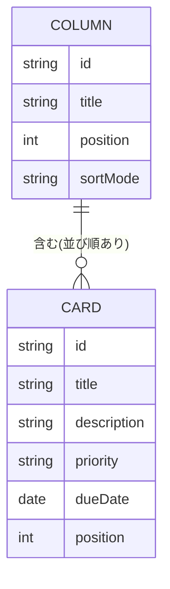
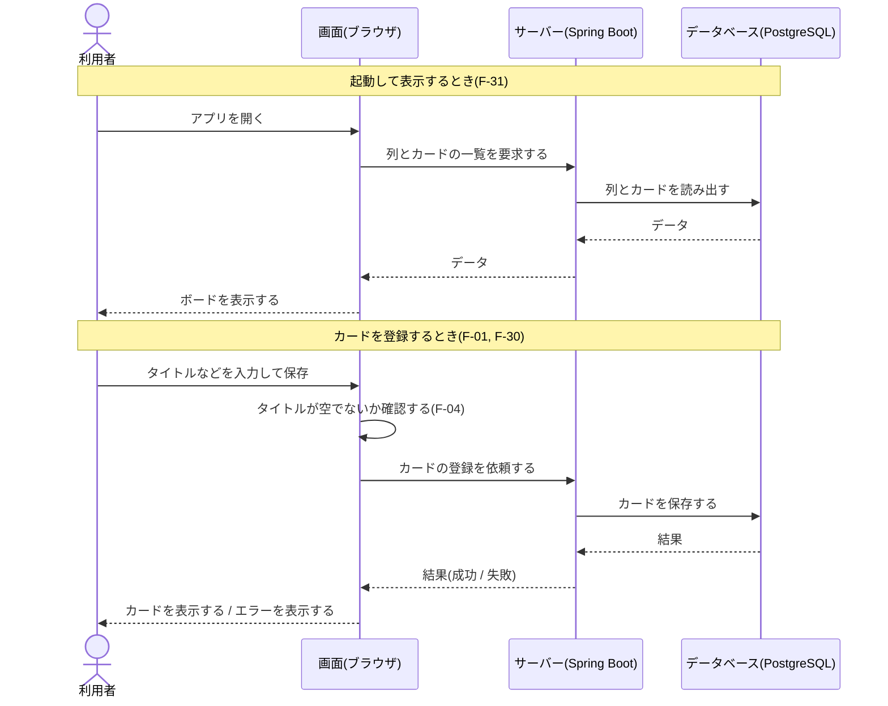
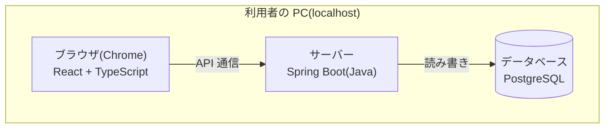

# データの整理(概念ER図・データフロー・システム構成)

| 項目 | 内容 |
|---|---|
| 版 | 0.5(下書き) |
| 更新日 | 2026-11-26 |
| 状態 | レビュー待ち |
| 上位文書 | [要件定義書](requirements.md) |

> ここは**概念レベル**です。テーブル定義・型・制約を含む詳細な ER 図は、基本設計(`docs/design/database.md`)で作ります。

## 1. 概念ER図

図の見方:データの種類(四角)と、その関係(線)を表します。「1つの列に、複数のカードが入る」ことを示します。
※ 項目の型・制約・テーブル定義は、基本設計で決めます。型は、図を書くための仮のものです。

- 「position」は、列やカードの**並び順**を表します。
- 「sortMode」は、列ごとの並び順の選択(手動/優先度順/期限順。F-42)です。初期値は「手動」で、手動のときの順番は、カードの「position」で決まります。
- ボード(画面全体)は1つだけなので、図には入れていません。

### 現在の実装との対応(参考)
概念ER図は、次のように実装済みです(未決事項 [Q6](requirements.md) で決定)。
- COLUMN は、`board_column` テーブル(`BoardColumn`)。並び順の選択(`sort_mode`)は、MANUAL / PRIORITY / DUE_DATE(初期値 MANUAL)。初期列「未着手」「進行中」「完了」(F-10)は、マイグレーションで登録する。
- CARD は、`task` テーブル(`Task`)。`column_id` で、入っている列を参照する。列を削除すると、その列のカードも一緒に削除される(F-13)。
- 概念ER図にない項目として、作成日時(`created_at`)、更新日時(`updated_at`)を追加している。
- 優先度(`priority`)は、HIGH / MEDIUM / LOW(初期値 MEDIUM)。タイトルは必須で、100 文字まで(仮)。

## 2. データフロー図

図の見方:上から下へ、時間の流れに沿って、データがどこを通るかを表します。

## 3. システム構成図

図の見方:このアプリを構成する部品と、その関係です。すべて、利用者の PC の中で動きます。

## 関連文書
- 機能の定義:[機能要件](functional.md)
- 使う技術:[技術選定](tech-stack.md)
- 動作環境・保全:[非機能要件](non-functional.md)
