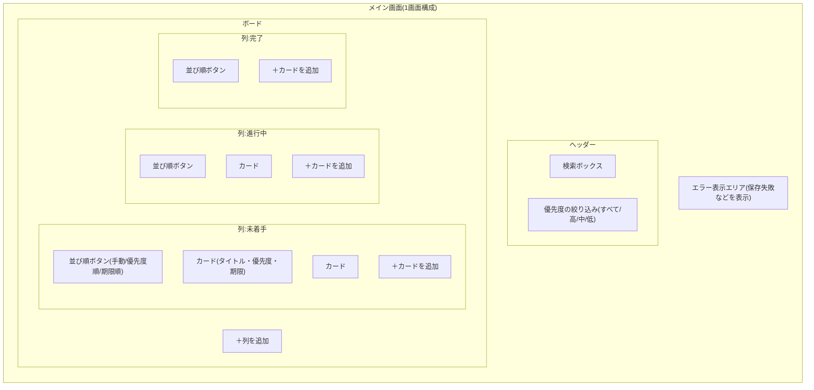
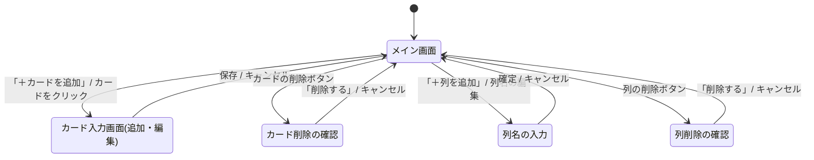
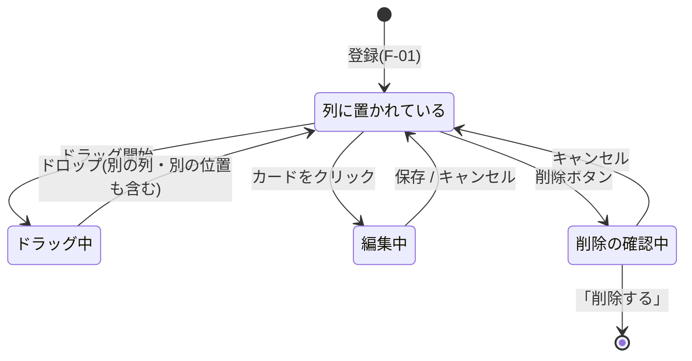

# 画面仕様

| 項目 | 内容 |
|---|---|
| 版 | 0.4(下書き) |
| 更新日 | 2026-11-26 |
| 状態 | レビュー待ち |
| 上位文書 | [要件定義書](requirements.md) |

> 色・余白・文言などの詳細な画面設計は、基本設計(`docs/design/`)で決めます。ここでは、画面の構成・動作・遷移を決めます。

## 1. 画面レイアウト図(ワイヤーフレーム)

図の見方:入れ子の枠が、画面の部品の配置です。外側がメイン画面、内側が各部品です。
※ Mermaid には、ワイヤーフレーム専用の記法がないため、枠の入れ子で表現しています。

## 2. 各部品の表示と動作

| 部品 | 表示内容 | 動作 |
|---|---|---|
| 検索ボックス | 入力欄 | 文字を入力すると、タイトルに含むカードだけを表示する(F-40) |
| 優先度の絞り込み | 選択肢(すべて/高/中/低) | 選ぶと、該当する優先度のカードだけを表示する(F-41) |
| 列 | 列名、カード数、並び順ボタン、カードの一覧、「＋カードを追加」、列の編集・削除 | 列名の編集(F-12)、列の削除(F-13) |
| 並び順ボタン(列ごと) | 3つのボタン:「手動」「優先度順」「期限順」。選択中のボタンを強調する。マウスを置くと、「優先度が高い順(高→中→低)」などの説明を表示する | 押すと、その列だけ並び順が変わる(F-42)。「優先度順」「期限順」の列では、列内のドラッグによる並び替えはできない(ほかの列からの移動はできる) |
| カード | タイトル、優先度、期限日(期限切れは強調) | クリックで編集(F-02)、削除ボタン(F-03)、ドラッグで移動(F-20, F-21) |
| 「＋列を追加」 | ボタン | 列名を入力して、新しい列を追加する(F-11) |
| エラー表示エリア | エラーメッセージ | 保存失敗、サーバーに接続できない場合などを表示する |

## 3. 状態ごとの表示

| 状態 | 表示 |
|---|---|
| 初回起動(データなし) | 「未着手」「進行中」「完了」の3列を、カードなしで表示する |
| 列にカードがない | 列に「カードがありません」と薄く表示する |
| 検索・絞り込みの結果が0件 | 「該当するカードはありません」と表示する |
| 期限切れのカード | 期限日を赤色などで強調する(F-05) |
| 並び順が「優先度順」「期限順」の列 | カードを、その順に表示する。期限順では、期限なしのカードを最後に表示する(F-42) |
| サーバーに接続できない | エラー表示エリアに「サーバーに接続できません」と表示する |
| 保存に失敗 | エラー表示エリアに「保存できませんでした」と表示する |

## 4. 画面遷移図

図の見方:四角が画面、矢印が「どの操作で、どの画面に移るか」です。メイン画面から、必要なときだけ入力画面や確認画面(ダイアログ)が開きます。

## 5. カードの状態遷移図

図の見方:1枚のカードが、どんな状態を経るかを表します。

## 関連文書

- 機能の定義:[機能要件](functional.md)
- 操作の流れ:[ユースケースと操作フロー](usecases.md)
