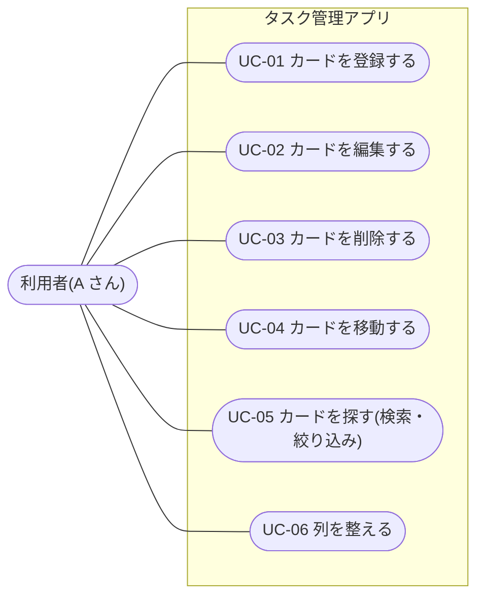
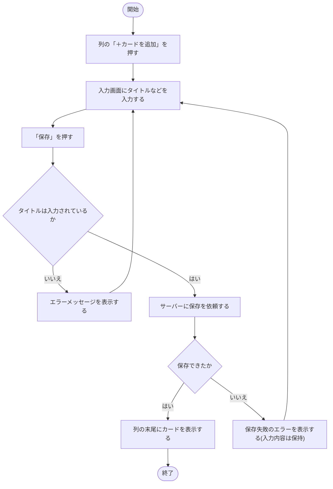

# ユースケースと操作フロー

| 項目 | 内容 |
|---|---|
| 版 | 0.2(下書き) |
| 更新日 | 2026-11-26 |
| 状態 | レビュー待ち |
| 上位文書 | [要件定義書](requirements.md) |

> **ユースケース**とは、「利用者が、システムを使って何をするか」を、1つの目的ごとにまとめたものです。
> 機能の ID(F-xx)の内容は、[機能要件](functional.md)を参照してください。

## 1. ユースケース図

図の見方:左の人が利用者、丸い枠が、利用者がアプリでできることです。

## 2. ユースケース一覧と対応する機能

| ID | ユースケース | 目的 | 対応する機能 |
|---|---|---|---|
| UC-01 | カードを登録する | やることを漏れなく記録する | F-01, F-04, F-30 |
| UC-02 | カードを編集する | 内容や期限の変更を反映する | F-02, F-04, F-30 |
| UC-03 | カードを削除する | 不要になったタスクを消す | F-03, F-30 |
| UC-04 | カードを移動する | 進み具合や順番を更新する | F-20, F-21, F-30 |
| UC-05 | カードを探す | 見たいタスクをすぐに見つける | F-40, F-41 |
| UC-06 | 列を整える | 自分に合った分け方にする | F-11, F-12, F-13, F-30 |

## 3. ユースケース記述(主なもの)

**UC-01 カードを登録する**

| 項目 | 内容 |
|---|---|
| 事前条件 | メイン画面が表示されている |
| 基本の流れ | 1. 列の「＋カードを追加」を押す。 2. 入力画面で、タイトルなどを入力する。 3. 「保存」を押す。 4. カードが、その列の末尾に表示される |
| 例外 | タイトルが空:エラーを表示し、登録しない。 保存に失敗:エラーを表示し、入力内容は保持する |
| 事後条件 | カードがデータベースに記録されている |

**UC-04 カードを移動する**

| 項目 | 内容 |
|---|---|
| 事前条件 | 1枚以上のカードが表示されている |
| 基本の流れ | 1. カードをドラッグする。 2. 移動したい列・位置にドロップする。 3. カードが新しい位置に表示される |
| 例外 | 保存に失敗:エラーを表示し、元の位置に戻す |
| 事後条件 | 新しい列と順番が、データベースに記録されている |

**UC-05 カードを探す**

| 項目 | 内容 |
|---|---|
| 事前条件 | メイン画面が表示されている |
| 基本の流れ | 1. 検索ボックスに文字を入力する、または優先度を選ぶ。 2. 条件に合うカードだけが表示される。 3. 条件を空にすると、全件が表示される |
| 例外 | 該当するカードが0件:「該当するカードはありません」と表示する |
| 事後条件 | データは変更されない(表示だけが変わる) |

**UC-06 列を整える**

| 項目 | 内容 |
|---|---|
| 事前条件 | メイン画面が表示されている |
| 基本の流れ | 追加:「＋列を追加」で名前を入力する。 名前変更:列名を編集して確定する。 削除:列の削除を押し、確認で「削除する」を選ぶ |
| 例外 | 列の削除では、列内のカードも消えることを確認画面に表示する |
| 事後条件 | 変更が、データベースに記録されている |

## 4. 操作フロー図:カードを登録する

図の見方:上から下へ、操作の流れを追います。ひし形は、条件による分かれ道です。

## 関連文書
- 機能の定義:[機能要件](functional.md)
- 画面での見え方:[画面仕様](screens.md)
